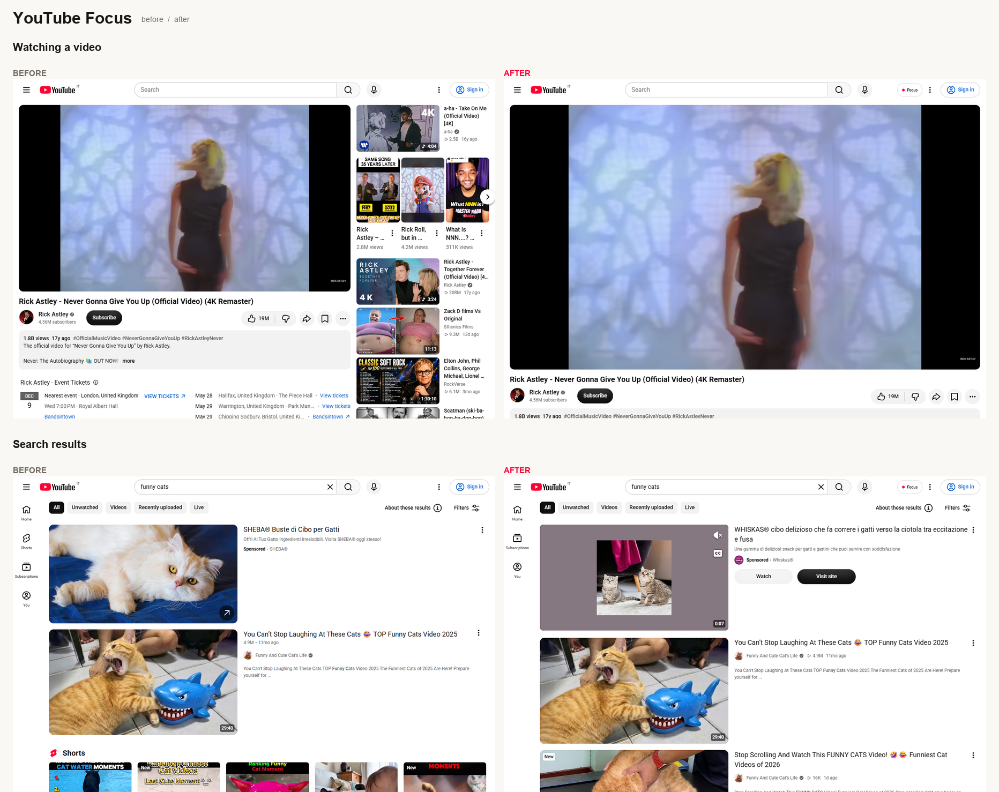

# YouTube Focus

A userscript that hides Shorts and the sidebar on YouTube, turns autoplay off,
and keeps your playback speed for the next video.



## Install

Install it from Greasy Fork:

https://greasyfork.org/en/scripts/606925-youtube-focus

Click **Install this script**. You need Violentmonkey or Tampermonkey for that.

On Chrome, extensions can't run user scripts until you allow it. Right click the
manager's icon, go to Manage extension, and turn on **Allow user scripts**. On
older Chrome it's Developer mode at chrome://extensions instead. If the script
seems to do nothing, that switch is almost always why.

The source is `youtube-focus.user.js` in this repo. Opening the raw file works
too if you would rather install straight from GitHub.

## What it does

- **Shorts**: hides the shelves, the Shorts cards in search, and the Shorts link
  in the sidebar. A /shorts/ link opens as a normal watch page.
- **Focus mode**: hides the recommendation column next to a video, plus the end
  screen cards.
- **Autoplay**: clicks YouTube's autoplay switch off on every video.
- **Speed**: remembers the speed you last picked and applies it to the next
  video. A small chip in the masthead shows it, click it to go back to 1x.
- **Home feed**: off by default. Replaces the feed with a search prompt.

The Focus button in the top right opens the settings. Alt+F toggles focus mode
and Alt+J opens the panel. The toggles are also in the userscript manager's menu
and get saved between visits.

## Where to look

- A video: https://www.youtube.com/watch?v=dQw4w9WgXcQ - the recommendation
  column is gone and autoplay is off.
- A search: https://www.youtube.com/results?search_query=funny+cats - the Shorts
  shelf and the Shorts link in the sidebar are gone.
- A Shorts link: https://www.youtube.com/shorts/X4dGtpUD3gA - opens as a normal
  watch page.
- Playback speed: pick 1.5x on one video, open another, it keeps 1.5x.

## Notes

- Written for the desktop site. m.youtube.com is matched but the layout tweaks
  are for the desktop player.
- YouTube changes its DOM all the time. Hiding is done with CSS keyed on
  attributes the script sets, so when a selector breaks that one thing stops
  working instead of breaking the page.
- The speed setting needs a short retry loop because the player resets the rate
  while a video loads.
- Speeding up an ad is a side effect of the speed setting.

## Test

The test opens real YouTube in Chrome, once plain and once with the script
injected, and checks the difference. It also writes the screenshots in docs/.

```
npm install
node test/e2e.mjs
```

It uses the Chrome already installed on the machine. Set CHROME_PATH for another
browser, HEADED=1 to watch it run.

## Credits

AI was used to help write the code in this repo. The idea, the settings and the
testing are mine.

## License

MIT, see LICENSE.
